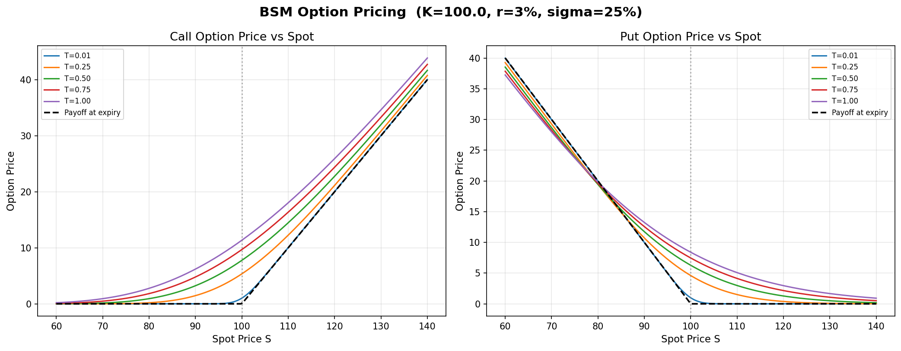
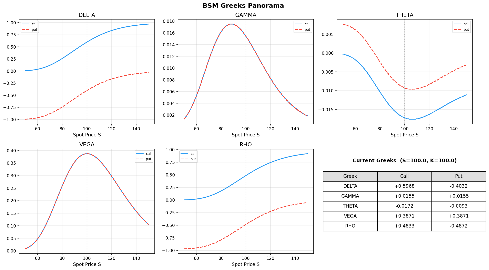

# Black–Scholes–Merton 期权定价与可视化

Python 实现欧式看涨/看跌期权解析定价、Delta/Gamma/Theta/Vega/Rho、看涨看跌平价、几何布朗运动路径和蒙特卡洛价格验证。

## 快速开始

```bash
python bsm_pricing.py
python -m pip install -r requirements.txt
python examples/render_charts.py
```

定价核心只用 Python 标准库；图形需要 NumPy 与 Matplotlib。Python 3.10+。原来的交互入口仍为 `python bsm_visualization.py`，无界面环境用上述导出脚本，PNG 写入 `figures/`。

```python
from bsm_pricing import bsm_price, bsm_greeks
price = bsm_price(100, 100, 1.0, 0.05, 0.2, 'call')
greeks = bsm_greeks(100, 100, 1.0, 0.05, 0.2, 'call')
print(price, greeks)
```

## 模型

无分红的欧式期权：

$$d_1=\frac{\ln(S/K)+(r+\sigma^2/2)T}{\sigma\sqrt T},\quad d_2=d_1-\sigma\sqrt T$$
$$C=S\Phi(d_1)-Ke^{-rT}\Phi(d_2),\quad P=Ke^{-rT}\Phi(-d_2)-S\Phi(-d_1)$$

`S` 为标的价格，`K` 为行权价，`T` 为年，`r` 与 `sigma` 均以小数输入。Theta 输出按天；Vega/Rho 分别按波动率与利率变动1个百分点输出。

假设波动率和无风险利率恒定、连续交易、无交易成本。本实现未加入股息、早行权或真实盘口约束；笑脸图为说明性设定，并非拟合真实市场数据。

## 图示




其余图涵盖模拟路径、波动率与期限曲面、说明性波动率笑脸和时间衰减。定价核心及原可视化脚本保持原有实现；新增运行说明与导出入口。开发和整理使用 AI 辅助。
